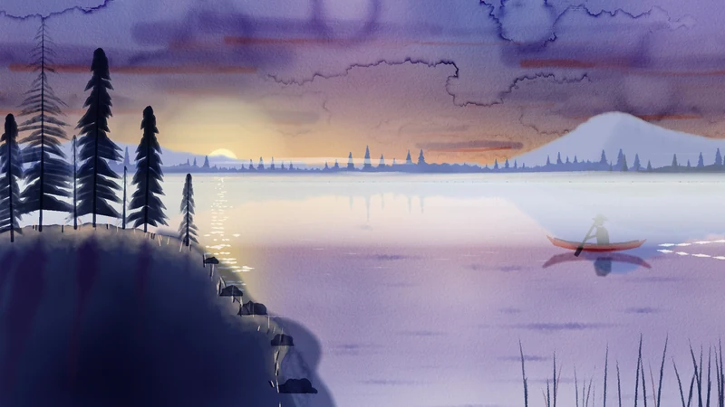
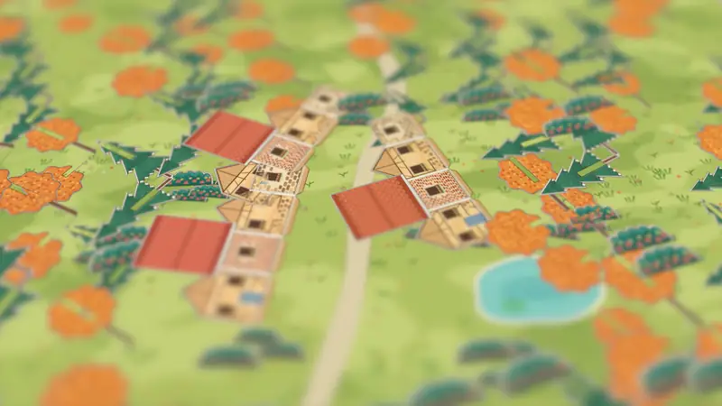
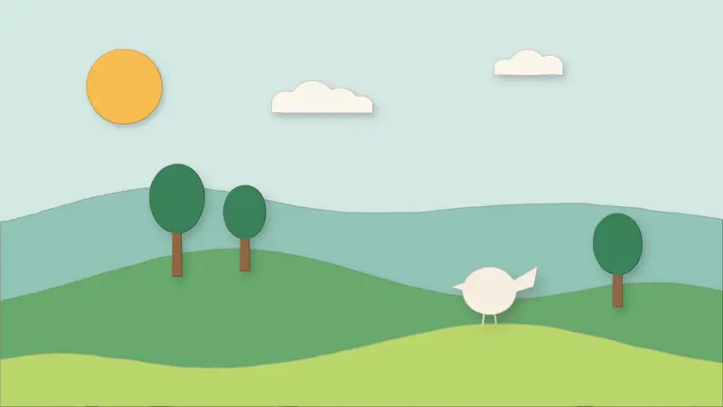
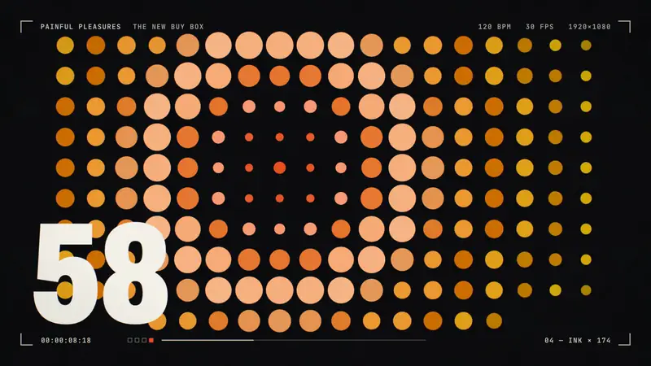
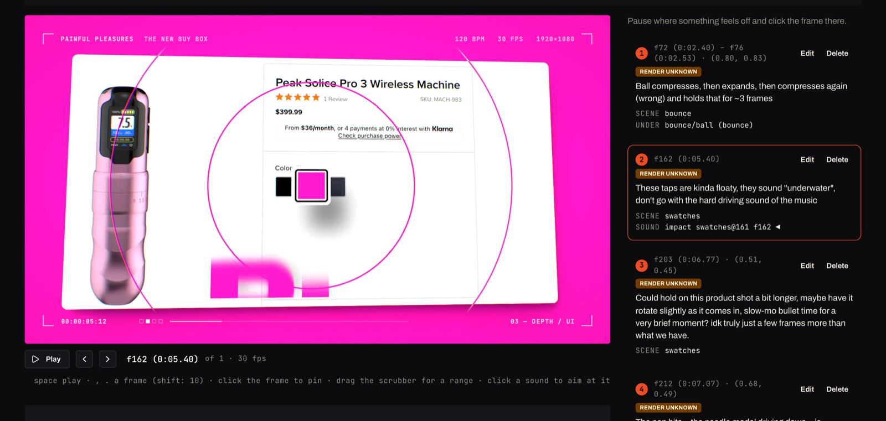

<p align="center">
  
</p>

# media-studio

<h3>A media studio for you and your agents: code-based tools for making video and images, and a review app where you
leave specific notes, frame by frame.</h3>

https://github.com/user-attachments/assets/d95c1e29-c845-460f-a8fc-84c1fae775ff

<p align="center"><sub>A 25-second product reel made with media-studio: kinetic type and 3D, cut to a 120 BPM track.
<a href="https://www.youtube.com/watch?v=EmcyuoMzjZM">Watch it in full quality on YouTube</a>.</sub></p>

Your coding agent drives the `studio` CLI, with skills that ship as a Claude Code plugin. You watch what it makes in the
review app and point at what should change. With media-studio, your agent can:

- **Paint** in watercolour, gouache, crayon, pencil and ink on the GPU, then animate the painting, wrap it onto a 3D
  object or fold it up as cut paper.
- **Cut motion to music**: kinetic type, 3D scenes and transitions timed to the beats and bars of a track it can trim
  to length.
- **Film your web pages** in a browser, with the clicks, scrolls and typing written per shot, and zoom to whatever the
  voiceover names.
- **Voice, score and mix** a video, starting on a free draft voice so the plan is right before anything costs money.
- **Block a shot out in 3D** for your sign-off before it pays for generated footage.
- **Study a reference video** you like: its cuts against the beat, its motion and its palette, frame by frame.
- **Find your best takes** in recordings from Studio Recorder, transcribed and searchable.
- **Take your notes in a review app**, pinned to a frame, a word or a region, and answer them while you watch.
- **Check its own frames** before you see them, and refuse a still whose text is cut off.

Each video or set of stills is a project in `work/` inside your clone. Every frame is code, built on
[Remotion](https://www.remotion.dev), so a note like "hold that shot longer" is an edit and a re-render.

## Painting



A GPU paint engine lays paint the way it behaves: washes bleed into wet paper, and a wash laid over a dry one tints
it. Each painted look comes from a brush pack you own (Procreate or Photoshop), imported once as a private style. The
lake above is one painting animated from dawn to dusk.

## Painting on 3D, and cut paper

<table>
  <tr>
    <td width="50%"></td>
    <td width="50%"></td>
  </tr>
  <tr>
    <td>Flowers painted onto a turning mug, opening on each beat</td>
    <td>A cut-paper village folding up out of the ground</td>
  </tr>
</table>

A painting wraps onto a 3D model as its texture, or becomes paper pieces that fold, pop up and cast shadows.



## Motion cut to music



The agent plans a music-cut piece on the track's bars, so each scene lands on a downbeat. It fits the track to the
video's length by dropping or repeating whole bars, and drafts sound effects from what happens on screen.

## A review app for the important bits



Pin a note to a frame of a render, a word of the script or a region of a still. The note saves into the project and
follows its moment into each new render. Sign a scene off, and if it changes afterwards the app marks it "Changed since
you approved it".

The agent stays connected while you review. It wakes on each note (`studio review watch`), replies in the thread with a
fix and its render, asks you about specific frames, and posts candidates for you to pick between.

## Studio Recorder

A macOS menu-bar app in this repo (`studio recorder install`). One key records screen, camera, mic and an input log,
each as its own file. Every take lands in a footage library on your machine, transcribed and searchable, so the agent
finds the good takes and cuts them into any project.

## Useful out of the box

The plugin's skills teach your agent the craft: capture, animation, painting, sound and handing work over for review.
They plan each video in steps of rising cost. You sign off a short written pitch, then the scene table, then an
animatic (every scene roughed in at its real timing on the free voice) before the agent pays for a real voice,
generated footage or finished animation.

## Example requests

- *"Make a 30-second teaser for our new pricing page."*
- *"I just recorded a demo. Find the best takes and cut it to two minutes."*
- *"Make an OG image and a YouTube thumbnail for this launch post."*
- *"Paint a watercolour title card for the intro, and have it bloom in on the first beat."*
- *"Cut a 15-second reel to this track, a shot on every bar."*

## Cost and requirements

Captures, motion, painting, renders, the draft voice, transcription (local whisper), sound effects, the mix and review
all run free on your machine. A real voice and generated images, music and footage go through
[OpenRouter](https://openrouter.ai): add an `OPENROUTER_API_KEY` to use them. Every paid verb states its price in its
`--help`, and each paid result is cached, so asking for the same thing again costs nothing.

You need a Mac with Node 24, git, ffmpeg and a GPU that Chrome can use.

## Getting started

1. Clone it somewhere it can stay: `git clone https://github.com/GLips/media-studio.git`
2. Add the skills to Claude Code from your clone:

   ```
   /plugin marketplace add <path to your clone>
   /plugin install media-studio@media-studio
   ```

3. Tell your agent: *"Set up media-studio."* It installs the CLI, makes your workspace and asks about keys.

Then ask for a video or a still from any repo. The plugin loads the skills from your clone, so `git pull` and `npm install` there
update the studio and its skills together. Your projects stay private in `work/`, a git repository of your own.

## For agents

If a person asks you to install this repo, run these steps yourself:

```sh
node -v; git --version; ffmpeg -version | head -1   # Node 24 or later; if any is missing: brew install node git ffmpeg
git clone https://github.com/GLips/media-studio.git <dir>   # ask where it should live; it stays there
cd <dir>
npm install
npm link                     # puts `studio` on the PATH, pointing at this clone
studio workspace init        # makes work/, the person's private repository of projects
claude plugin marketplace add "$PWD"
claude plugin install media-studio@media-studio
cd ~ && studio home          # prints the clone's path when the install worked
```

Then tell the person to start a new session (or run `/reload-plugins`) and run the `studio-setup` skill. It sees the CLI
is installed and picks up at the workspace's remote and the keys.

To learn what the studio can do, run `studio --help`, then `studio <verb> --help`.  To make something, start with the skill that fits:

- `studio-setup`: installs the studio, then sets up keys, the workspace, brand kits and product repos.
- `video-kickoff`: takes a brief to an animatic the person has signed off. Every video starts here.
- `video-capture`: films a site's shots from a project's `capture.ts`.
- `video-motion`: animates an approved animatic into finished scenes.
- `paint`: paints stills and shots in watercolour, gouache, crayon, pencil, ink and cut paper.
- `video-gen`: generates footage no capture can give, after a rough 3D or flat mock-up of the shot is approved.
- `video-sound`: adds music, sound effects and the mix.
- `stills`: makes OG images, thumbnails and social posts at every size.
- `studio-review`: hands work to the person in the review app and reads back their notes and choices.

To work on the studio itself, read `CLAUDE.md`.

## License

MIT. Remotion, which the studio renders with, has its own licence: free for individuals and small companies, and
larger companies need a [Remotion company licence](https://www.remotion.dev/license).
