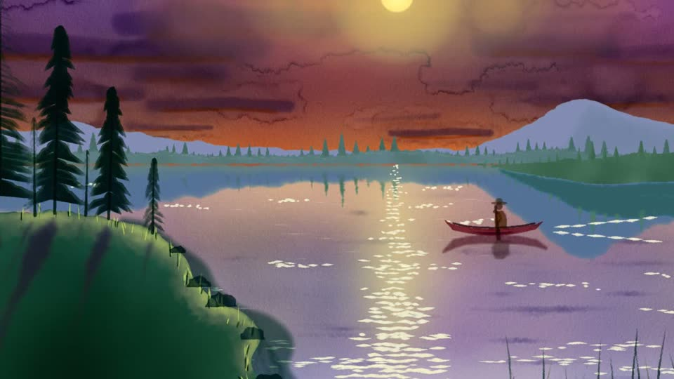

# media-studio

<!-- demo video -->

Tell your coding agent what video you want, and it makes it: the story, the shots, the motion, the voice, the music
and the mix, rendered to an MP4 you review in your browser. The skills ship as a Claude Code plugin and work from any
repo you're in; the `studio` CLI they drive runs from any agent's shell. Every frame is code (built on
[Remotion](https://www.remotion.dev)), so a note like "hold that shot longer" becomes an edit to the scene's code and a
re-render.


## Features

Each video is a project: a folder in `work/` inside your clone of this repo, separate from the product repo the video
is about. Its plan is the project's `storyboard.ts`: a brief, then a row per scene with its lines and the cues the
picture moves on. Your agent writes the plan, films and animates the scenes, and voices and scores them, all in code,
using the `studio` CLI. You steer it with notes on the plan and the renders.

- **Your notes land exactly where you point.** The review app reads and writes the project's own files. Pin a note to a
  frame, a word of the script or a region of a still; it saves to the project, and the agent, waiting on
  `studio review watch`, wakes to read it and replies with a fix and a new render. A note follows its moment into each new
  render. When you fix a line on the plan page, the change saves into `storyboard.ts`. You approve by signing a scene
  off in the app, and if the scene changes afterwards, the app marks the sign-off as changed and shows what was
  reworded.
- **You sign off cheap before anything gets expensive.** Each video climbs a ladder: a treatment (a short written
  pitch), the scene table in `storyboard.ts`, then an animatic (every scene roughed in at its real timing, played on a
  free draft voice from macOS `say`). Only after you approve the animatic does it get a real voice, generated footage
  or finished animation.
- **It films your product itself.** It opens your web pages in a browser, writes the clicks, scrolls and typing for
  each shot, records them, then zooms and highlights the exact element each line talks about. It can also build
  scenes from your repo's own React components.
- **It checks its own work.** `studio check` measures every frame for highlights off screen, clicks hidden under a
  caption, and held moments that leave the screen before a viewer can read them. `studio still` refuses to write an
  image whose text is cut off, sits under YouTube's duration badge or fails contrast.
- **It paints.** The agent writes a painting as a `*.painting.ts` document, and a GPU paint engine on your machine
  lays it in watercolour, gouache, crayon, pencil or ink the way paint behaves: washes bleed into wet paper, and a
  wash laid over a dry one tints it. Paintings animate, wrap onto 3D objects and fold up as cut paper (painted pieces
  that stand and fold like a paper diorama).
- **It edits your own footage.** A macOS menu-bar recorder in this repo (`studio recorder install`) captures screen,
  camera, mic and every input as separate files. Each take goes into a footage library on your machine, transcribed
  and searchable, that any project can cut from.

<table>
  <tr>
    <td></td>
    <td></td>
    <td></td>
  </tr>
  <tr>
    <td>A lake from dawn to dusk, in watercolour</td>
    <td>A cut-paper village, folding up on the music</td>
    <td>A painted mug, its petals opening on each beat</td>
  </tr>
</table>

## Example requests

- *"Make a 30-second teaser for our new pricing page."*
- *"Walk through signing up and creating a first project, with a voiceover, for the docs."*
- *"Make App Store screenshots for the app in this repo."*
- *"I just recorded a demo. Cut it down to the best two minutes and tighten the pauses."*
- *"Make an OG image and a YouTube thumbnail for this launch post."*
- *"Paint a watercolour title card for the intro, and have it bloom in on the first beat."*
- *"Cut a 15-second reel to this track, a shot on every bar."*

## Cost and requirements

Captures, motion, painting, renders, the draft voice (macOS `say`), transcription (local whisper), sound effects, the
mix and review all run free on your machine. A real voice and generated images, music and footage go through
[OpenRouter](https://openrouter.ai): add an `OPENROUTER_API_KEY` to unlock them. Every paid verb states its price in its `--help`, and each paid result is
cached, so asking for the same thing again costs nothing.

You need a Mac with Node 24, git, ffmpeg and a GPU that Chrome can use.

This repo is MIT-licensed. Remotion, which it renders with, has its own licence: it's free for individuals and small
companies, and larger companies need a [Remotion company licence](https://www.remotion.dev/license).

## Getting started

1. Clone it somewhere it can stay: `git clone https://github.com/GLips/media-studio.git`
2. Add the skills to Claude Code from your clone:

   ```
   /plugin marketplace add <path to your clone>
   /plugin install media-studio@media-studio
   ```

3. Tell your agent: *"Set up media-studio."* It installs the CLI, makes your workspace and asks about keys.

Then ask for a video from any repo. The plugin loads the skills straight from your clone, so a `git pull` there,
then `npm install`, updates the studio and its skills together.

Your projects live in `work/`, a git repository of your own inside the clone. They stay private while the studio
updates around them.

## For agents

If a person asks you to install this repo, run these steps yourself:

```sh
node -v; git --version; ffmpeg -version | head -1   # Node 24 or later; if any is missing: brew install node git ffmpeg
git clone https://github.com/GLips/media-studio.git <dir>   # ask where it should live; it stays there
cd <dir>
npm install
npm link                     # puts `studio` on the PATH, pointing at this clone
studio workspace init        # makes work/, the person's private repository of projects
claude plugin marketplace add "$PWD"
claude plugin install media-studio@media-studio
cd ~ && studio home          # prints the clone's path when the install worked
```

Then tell the person to start a new session (or run `/reload-plugins`) and run the `studio-setup` skill. It sees the
CLI is installed and picks up at the workspace's remote and the keys.

To learn what the studio can do, run `studio --help`, then `studio <verb> --help`. `studio api` lists what a
project's scenes can import. To make something, start with the skill that fits:

- `studio-setup`: installs the studio, then walks the person through keys, the workspace, brand kits and product
  repos.
- `video-kickoff`: takes a brief to an animatic the person has signed off. Every video starts here.
- `video-capture`: films a site's shots from a project's `capture.ts`.
- `video-motion`: animates an approved animatic into finished scenes.
- `paint`: paints stills and shots in watercolour, gouache, crayon, pencil, ink and cut paper.
- `video-gen`: generates footage no capture can give, after a rough 3D or flat mock-up of the shot is approved.
- `video-sound`: adds music, sound effects and the mix.
- `stills`: makes OG images, thumbnails and social posts at every size.
- `studio-review`: hands work to the person in the review app and reads back their notes and choices.

To work on the studio itself, read `CLAUDE.md`.

## License

MIT
