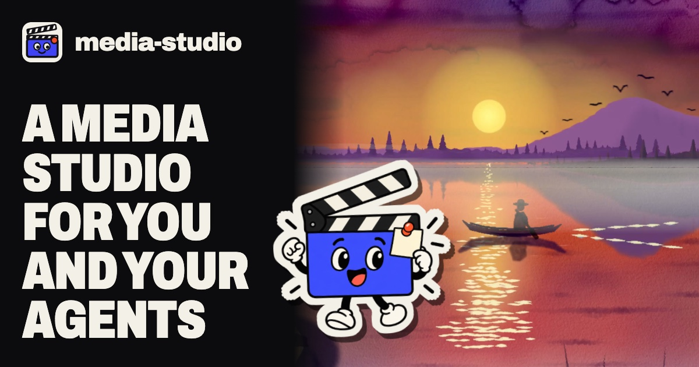
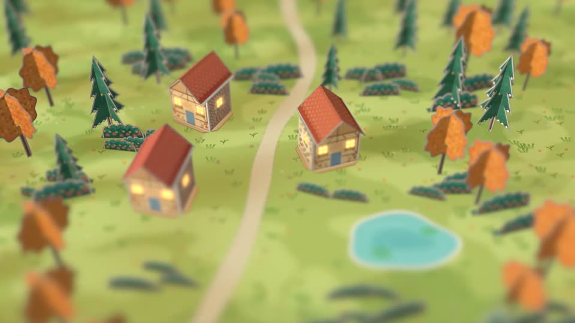

<p align="center">
  
</p>

# media-studio

<h3>A media studio for you and your agents: code-based tools for making video and images, and a review app where you
leave specific notes, frame by frame.</h3>

<!-- demo video -->

Your coding agent drives the `studio` CLI with skills that ship as a Claude Code plugin. It plans a video, captures,
animates, paints, voices, scores and renders it, or makes a still, and you look at the result in the review app and point at what should
change. The agent takes the drudgery out of the basic tasks, so your attention goes to the parts that matter.

Each video or set of stills is a project, a folder in `work/` inside your clone. A video's plan is `storyboard.ts`: a brief, then a row per
scene with its lines and cues. Every frame is code (built on [Remotion](https://www.remotion.dev)), so a note like "hold
that shot longer" becomes an edit and a re-render.

## Building blocks for many styles

Your agent builds each video or image from parts it edits in code: captured UI, motion, 3D blockouts, flat 2D, music-cut timing,
generated footage and your own recordings.

- **It films your web pages itself.** It opens them in a browser, writes the clicks, scrolls and typing for each shot,
  then zooms and highlights the element each line talks about.
- **It paints.** A GPU paint engine lays watercolour, gouache, crayon, pencil and ink the way paint behaves: washes
  bleed into wet paper, and a wash laid over a dry one tints it. Paintings animate, wrap onto 3D objects and fold up as
  cut paper. Each painted look comes from a brush pack you own (Procreate or Photoshop), imported once as a private
  style.
- **It checks its own work.** `studio check` measures every frame for highlights off screen, clicks hidden under a
  caption, and moments that leave the screen before a viewer can read them. `studio still` refuses to write an image
  whose text is cut off, sits under a platform's buttons or fails contrast.

<table>
  <tr>
    <td></td>
    <td></td>
    <td></td>
  </tr>
  <tr>
    <td>A lake from dawn to dusk, in watercolour</td>
    <td>A cut-paper village, folding up on the music</td>
    <td>A painted mug, its petals opening on each beat</td>
  </tr>
</table>

## A review app for the important bits


Pin a note to a frame of a render, a word of the script or a region of a still. The note saves into the project and
follows its moment into each new render. Edit a line on the plan page and the change saves into `storyboard.ts`. Sign a
scene off, and if it changes afterwards the app marks the sign-off "Changed since you approved it" and shows what was
reworded.

The agent is connected to the app while you review. It wakes on each note (`studio review watch`), replies in the thread
with a fix and its render, asks you about specific frames, and posts candidates for you to pick between.

## Studio Recorder

Studio Recorder is a macOS menu-bar app in this repo (`studio recorder install`). One key records screen, camera, mic
and an input log, each as its own file. Every take goes into a footage library on your machine, transcribed and
searchable, so your agent can find the good takes and cut them into any project without you scrubbing through them.

## Useful out of the box

The plugin's skills teach your agent the craft, from capture and animation to painting, the mix and handing work over
for review. They plan each video in rungs of rising cost: you sign off a short written pitch, the scene table, then an
animatic (every scene roughed in at its real timing on a free macOS `say` voice) before the agent spends anything on a
real voice, generated footage or finished animation.

## Example requests

- *"Make a 30-second teaser for our new pricing page."*
- *"I just recorded a demo. Find the best takes and cut it to two minutes."*
- *"Make an OG image and a YouTube thumbnail for this launch post."*
- *"Paint a watercolour title card for the intro, and have it bloom in on the first beat."*
- *"Cut a 15-second reel to this track, a shot on every bar."*

## Cost and requirements

Captures, motion, painting, renders, the draft voice, transcription (local whisper), sound effects, the mix and review
all run free on your machine. A real voice and generated images, music and footage go through
[OpenRouter](https://openrouter.ai): add an `OPENROUTER_API_KEY` to use them. Every paid verb states its price in its
`--help`, and each paid result is cached, so asking for the same thing again costs nothing.

You need a Mac with Node 24, git, ffmpeg and a GPU that Chrome can use.

## Getting started

1. Clone it somewhere it can stay: `git clone https://github.com/GLips/media-studio.git`
2. Add the skills to Claude Code from your clone:

   ```
   /plugin marketplace add <path to your clone>
   /plugin install media-studio@media-studio
   ```

3. Tell your agent: *"Set up media-studio."* It installs the CLI, makes your workspace and asks about keys.

Then ask for a video or a still from any repo. The plugin loads the skills from your clone, so `git pull` and `npm install` there
update the studio and its skills together. Your projects stay private in `work/`, a git repository of your own.

## For agents

If a person asks you to install this repo, run these steps yourself:

```sh
node -v; git --version; ffmpeg -version | head -1   # Node 24 or later; if any is missing: brew install node git ffmpeg
git clone https://github.com/GLips/media-studio.git <dir>   # ask where it should live; it stays there
cd <dir>
npm install
npm link                     # puts `studio` on the PATH, pointing at this clone
studio workspace init        # makes work/, the person's private repository of projects
claude plugin marketplace add "$PWD"
claude plugin install media-studio@media-studio
cd ~ && studio home          # prints the clone's path when the install worked
```

Then tell the person to start a new session (or run `/reload-plugins`) and run the `studio-setup` skill. It sees the CLI
is installed and picks up at the workspace's remote and the keys.

To learn what the studio can do, run `studio --help`, then `studio <verb> --help`.  To make something, start with the skill that fits:

- `studio-setup`: installs the studio, then sets up keys, the workspace, brand kits and product repos.
- `video-kickoff`: takes a brief to an animatic the person has signed off. Every video starts here.
- `video-capture`: films a site's shots from a project's `capture.ts`.
- `video-motion`: animates an approved animatic into finished scenes.
- `paint`: paints stills and shots in watercolour, gouache, crayon, pencil, ink and cut paper.
- `video-gen`: generates footage no capture can give, after a rough 3D or flat mock-up of the shot is approved.
- `video-sound`: adds music, sound effects and the mix.
- `stills`: makes OG images, thumbnails and social posts at every size.
- `studio-review`: hands work to the person in the review app and reads back their notes and choices.

To work on the studio itself, read `CLAUDE.md`.

## License

MIT. Remotion, which the studio renders with, has its own licence: free for individuals and small companies, and
larger companies need a [Remotion company licence](https://www.remotion.dev/license).
